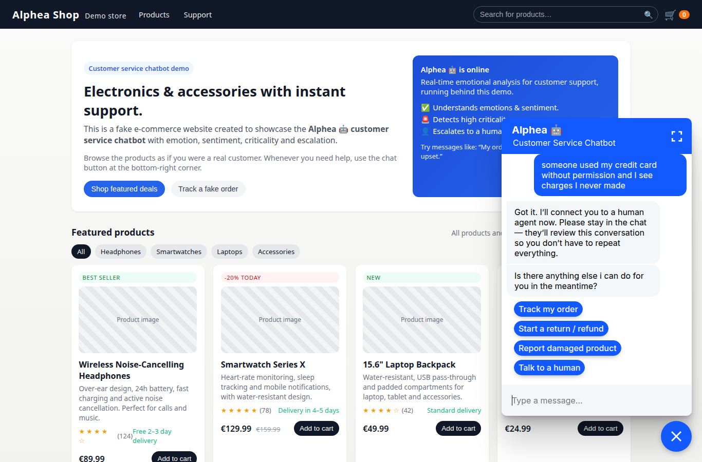
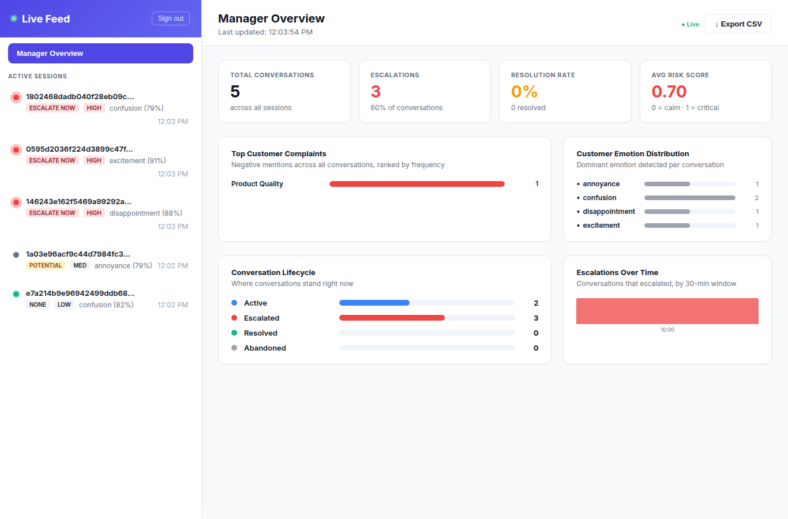

# Alphea

**An emotion- and risk-aware customer service chatbot that knows when to bring in a human.**

[](https://github.com/Ziad-Jreij/alphea-chatbot/actions/workflows/ci.yml)
[](LICENSE)


Alphea is an open-source e-commerce support bot built on [Rasa](https://rasa.com/). Every customer message goes through three AI models: **emotion detection**, **zero-shot criticality scoring** and **aspect-based sentiment analysis**. Together they decide, with a written reason, when a conversation should go to a human agent. A live agent dashboard shows every conversation as it happens, and two analytics datasets build up automatically.

<p align="center">
  
  
</p>

---

## Contents

- [Why Alphea](#why-alphea)
- [Quick start](#quick-start)
- [Things to try](#things-to-try)
- [Architecture](#architecture)
- [AI components](#ai-components)
- [Benchmark and performance](#benchmark-and-performance)
- [Configuration](#configuration)
- [Plugging in a real order system](#plugging-in-a-real-order-system)
- [Generated datasets](#generated-datasets)
- [Project structure](#project-structure)
- [Development](#development)
- [Troubleshooting](#troubleshooting)
- [Known limitations](#known-limitations)
- [Acknowledgements](#acknowledgements) · [License](#license)

---

## Why Alphea

Most support bots stop at intent recognition or a single sentiment score. Alphea combines **emotion awareness, criticality assessment, escalation logic and aspect-level analysis** in real time:

- **Criticality independent of emotion.** "I think someone stole my credit card" is emotionally calm but highly critical. Seven risk categories (safety, injury, fraud, account takeover, privacy, medical, legal) are scored independently on every message.
- **Explainable escalation.** Every decision comes with a reason code and a one-sentence explanation an agent can read.
- **Fine-grained emotion** (GoEmotions) smoothed over the conversation, so one ambiguous message doesn't flip the reading.
- **Aspect-level sentiment.** "Love the design, but the battery is awful" is broken down by aspect, so managers see which parts of the product draw complaints.
- **A real-time agent dashboard** with a manager overview, live session monitoring and CSV export.
- **Measured.** A 334-case benchmark with a held-out split, unit tests, recorded dialogue tests and CI.

It started as a university thesis project and has since been hardened for real use: Docker, PostgreSQL, authentication, monitoring, tests and CI.

---

## Quick start

**You need:** Docker with Compose v2, about **10 GB of free disk** and **8 GB of RAM**. No GPU or local Python is required.

```bash
git clone https://github.com/Ziad-Jreij/alphea-chatbot.git
cd alphea-chatbot
scripts/setup.sh        # generates .env with random secrets, fetches the pre-trained model
docker compose up -d    # pulls the images (or builds them), then starts everything
```

`setup.sh` prints the dashboard password it generated. It is also stored in `.env` as `DASHBOARD_PASSWORD`.

On the first start the action server downloads about 700 MB of AI model weights, so allow several minutes. `docker compose ps` shows every service as `healthy` when it's ready. Later starts take seconds.

| Open | URL |
|---|---|
| **Chat with the bot** | <http://localhost:5001/webchat.html> |
| Demo storefronts with the chat widget | [/theme1.html](http://localhost:5001/theme1.html) (shop) · [/theme2.html](http://localhost:5001/theme2.html) (bank) · [/theme3.html](http://localhost:5001/theme3.html) (SaaS support) |
| **Agent dashboard** (log in with the credentials from `setup.sh`) | <http://localhost:5001> |
| Grafana (user `admin`, password `GRAFANA_PASSWORD` in `.env`) | <http://localhost:3000> |
| Rasa HTTP API (needs `?token=$RASA_AUTH_TOKEN`) | <http://localhost:5005> |

<details>
<summary><b>No pre-trained model downloaded?</b> Train one (2–20 minutes, depending on CPU)</summary>

`setup.sh` downloads the model attached to the latest GitHub release. If there is none, or you changed `domain.yml`, `config.yml` or anything under `data/`, train it yourself:

```bash
docker compose run --rm --no-deps --user "$(id -u):0" rasa train
docker compose restart rasa
```

The newest model in `./models/` is loaded on start. Rasa serves the domain baked into the model, so edits are invisible until you retrain.
</details>

To stop the stack, run `docker compose down`. Add `-v` to also delete the database and the cached models.

---

## Things to try

Open the chat and type:

| Message | What happens |
|---|---|
| `where is my order ORD-12345` | Looks the order up in the mock order system (also `ORD-98765`, `ORD-55555`, `ORD-77777`) |
| `I want to return an item` | Runs the return form with order-ID validation |
| `someone used my credit card without permission` | **Fraud** risk category goes HIGH, and the chat is handed to a human with an explanation |
| `my charger started sparking and smoking` | **Safety hazard**: escalates even though the tone is calm |
| `I love the design but the battery is awful` | ABSA picks out the *battery* complaint (negative, "awful") and the *design* aspect, and it shows up under Top Customer Complaints |
| `this is the fourth time I'm writing about this` | Repeated-contact rule raises criticality |

Then open the dashboard to see each conversation's emotion, criticality, escalation reason and aspects, and the manager overview aggregating them.

---

## Architecture

```
                        ┌────────────────────────────────────────────────────┐
                        │                  Docker Network                     │
                        │                                                      │
  Browser / Widget ────▶│  Rasa Dialog Server  :5005                          │
                        │  • NLU: BERT features → DIETClassifier (intents)     │
                        │  • dialogue policies, forms                          │
                        │  • HTTP API protected by RASA_AUTH_TOKEN             │
                        │                     │ webhook                        │
                        │                     ▼                                │
                        │  Rasa Actions Server  :5055 (internal)               │
                        │  • emotion detection (DistilBERT)                    │
                        │  • criticality scoring (DeBERTa zero-shot)           │
                        │  • ABSA per turn (MiniLM)                            │
                        │  • order lookups (mock / REST)                       │
                        │  • pushes session state → Dashboard (ingest token)   │
                        │                     │                                │
                        │          ┌──────────┴──────────┐                     │
                        │          ▼                     ▼                     │
                        │  PostgreSQL  :5432     Dashboard (Flask)  :5001      │
                        │  • Rasa tracker store  • JWT-protected API           │
                        │  • chat_sessions table • serves webchat + dashboard  │
                        │                        • manager overview + CSV      │
                        │                                                      │
                        │  Prometheus  :9090     Grafana  :3000                │
                        │  scrapes /metrics      visualises all metrics        │
                        └────────────────────────────────────────────────────┘
```

Only the dashboard (5001) and Rasa (5005) are published. Postgres, Prometheus, Grafana and the action server listen on `127.0.0.1` only.

---

## AI components

All three models run in the **action server**, not in the Rasa NLU pipeline, so only one container needs torch and the model weights. Each user turn is scored once, in `_infer_emotion_slots` in [`actions/actions.py`](actions/actions.py).

### 1. Emotion detection ([`components/emotion.py`](components/emotion.py))

A DistilBERT model trained on GoEmotions classifies each message, and the raw labels are rolled up into six business-friendly buckets: **frustrated**, **anxious**, **disappointed**, **confused**, **neutral** and **satisfied**. A recency-weighted window over the last four turns keeps one ambiguous message from flipping the displayed emotion.

### 2. Criticality and escalation ([`components/criticality.py`](components/criticality.py))

Each message is scored **low**, **medium** or **high** with `MoritzLaurer/deberta-v3-base-zeroshot-v2.0` (~184 MB). By default (`CRITICALITY_STRATEGY=risk`), 15 descriptive categories are scored independently in one batched pass. HIGH means any of the seven risk categories clears 0.70. An emotion prior shifts the scores in log-odds space. Guardrails sit around the model:

- YAML keywords ([`data/criticality_keywords.yml`](data/criticality_keywords.yml)): high keywords decide immediately, medium keywords set a floor.
- Regex rules for safety, medical, finance, contrast ("works fine but the battery caught fire") and repeated contact. Finance rules ignore negation and hearsay ("there was no unauthorized charge", "I heard it's a scam").

A decay-weighted conversation-level score aggregates the turns, with a false-trigger penalty so one early spike doesn't hold a calm conversation at HIGH. Every decision emits a reason code and an explanation, for example: *"Escalated to HIGH because the model detected a safety hazard … (score 0.93)."*

### 3. Aspect-based sentiment analysis ([`components/absa.py`](components/absa.py))

MiniLM sentence embeddings match what a complaint is about (shipping, customer support, battery, product quality, …) and whether the opinion about it is positive, negative or neutral. Results are rolled up into business aspects, and the manager overview ranks the most-mentioned negative issues across all sessions.

---

## Benchmark and performance

[`scripts/eval_criticality.py`](scripts/eval_criticality.py) scores the criticality component on [`data/eval/criticality_benchmark.yml`](data/eval/criticality_benchmark.yml): 334 labelled messages split into **dev** (244, used for design and tuning) and **holdout** (90, written before the current design and only scored for reporting). Both splits are balanced across low, medium and high, and include negation, hearsay, contrast and "safety word" traps. It runs in two modes: **raw** (the model alone) and **pipeline** (the production path: keyword guardrails → model → emotion prior → structural rules).

Holdout results, production pipeline, CPU:

| Model | Strategy | Accuracy | Macro-F1 | HIGH precision | HIGH recall | LOW→HIGH false alarms | Median latency |
|---|---|---|---|---|---|---|---|
| **DeBERTa-v3-base** | **risk** (default) | **87.8%** | **87.5%** | **88.0%** | **73.3%** | 1 / 30 | ~200 ms |
| DeBERTa-v3-xsmall | risk | 78.9% | 78.8% | 80.0% | 66.7% | 3 / 30 | 56 ms |
| DeBERTa-v3-base | urgency (original) | 37.8% | 33.4% | 50.0% | 10.0% | 1 / 30 | 107 ms |

**Why the risk strategy:** the original design asked the model to rank "low / medium / high urgency", so a fire or a hacked account had to out-score every other reading of the message, and it mostly didn't (10% HIGH recall). Scoring each risk category independently fixes that.

Known misses on the holdout include a broken carbon-monoxide detector, a gas smell after an installation, a phishing request for a card PIN and a chargeback threat. **Treat escalation as decision support for agents, not as a safety system.**

Caveats: the holdout set was scored a second time after one category was reworded in response to a *live-testing* failure (plain return requests were being escalated), not a holdout error. 290 of the 334 labels were drafted in October 2026 and are marked `source: draft` pending human review. On the original 40-message thesis set, the original urgency strategy scores 60% raw, matching the thesis result.

Reproduce it (use the dev split for tuning and the holdout split for reporting):

```bash
docker compose run --rm --no-deps -v "$PWD":/app -w /app rasa-actions \
  python scripts/eval_criticality.py --strategies risk urgency --split holdout --show-errors
```

### CPU, GPU and model size

| Hardware | Criticality latency per message | Good for |
|---|---|---|
| CPU | ~200 ms (24-core laptop CPU, 8 torch threads; expect more on small cloud instances) | Development, demos, low traffic |
| NVIDIA GPU (e.g. T4) | ~30–50 ms | Production, more than 10 concurrent users |

The models run on the GPU when one is available and on the CPU otherwise (`GPU_ENABLED=auto`). To use a GPU in Docker:

1. Install the [NVIDIA Container Toolkit](https://docs.nvidia.com/datacenter/cloud-native/container-toolkit/latest/install-guide.html) on the host.
2. Uncomment the `deploy:` block under `rasa-actions` in [`docker-compose.yml`](docker-compose.yml).
3. In `.env`, set `TORCH_INDEX=https://download.pytorch.org/whl/cu128` and `GPU_ENABLED=true`, then rebuild: `docker compose up -d --build rasa-actions`. The default image ships CPU-only torch.

On a small CPU-only machine, `CRITICALITY_MODEL=MoritzLaurer/deberta-v3-xsmall-zeroshot-v1.1-all-33` is about 3.5× faster at a cost of about 9 points of accuracy (see the table above).

---

## Configuration

Everything is configured through `.env`. `scripts/setup.sh` creates it from [`.env.example`](.env.example), which documents every variable. The main ones:

| Variable | Default | Description |
|---|---|---|
| `JWT_SECRET_KEY`, `DASHBOARD_INGEST_TOKEN`, `RASA_AUTH_TOKEN` | _(required, generated)_ | Random secrets of at least 32 characters. Services refuse to start without them. |
| `DASHBOARD_USERNAME` / `DASHBOARD_PASSWORD` | `admin` / _(required, generated)_ | Dashboard login. The password must be at least 12 characters and not a default. |
| `GRAFANA_PASSWORD` | _(required, generated)_ | Grafana admin password |
| `DB_PASSWORD` | _(generated)_ | Postgres password. It is only read when the database volume is first created. |
| `CORS_ORIGINS`, `RASA_CORS_ORIGINS` | `*` | Allowed origins for the dashboard API and the chat socket. Set them to your domain in production. |
| `TRUSTED_PROXY_COUNT` | `0` | Number of reverse proxies in front of the dashboard. `X-Forwarded-For` is trusted only when this is above 0. |
| `ALPHEA_VERSION` | `latest` | Tag of the pre-built images to pull. |
| `GPU_ENABLED` | `auto` | `auto`, `true` (fail without a GPU) or `false` |
| `CRITICALITY_MODEL` | `MoritzLaurer/deberta-v3-base-zeroshot-v2.0` | Hugging Face zero-shot model for criticality |
| `CRITICALITY_STRATEGY` | `risk` | `risk` or the original `urgency` |
| `TORCH_NUM_THREADS` | min(8, cores) | CPU threads for the models. More than about 8 increases tail latency. |
| `PRELOAD_MODELS` | `true` | Load the models before the action server accepts requests |
| `ORDER_PROVIDER` | `mock` | `mock`, or `rest` for a real backend (see below) |

For deploying beyond localhost (TLS, CORS, which ports to keep private), see [SECURITY.md](SECURITY.md).

---

## Plugging in a real order system

By default the bot uses an in-memory mock with four sample orders. To connect a real backend, set `ORDER_PROVIDER=rest`, `ORDER_API_BASE_URL` and, if needed, `ORDER_API_KEY` (sent as a bearer token). The REST provider expects:

```
GET   {base_url}/orders/{order_id}      → order object
GET   {base_url}/orders?email={email}   → list or {"orders": [...]}
PATCH {base_url}/orders/{order_id}      → body {"address": "..."}
```

Each order object must include `status`, `eta`, `created_at`, `address` and `email`. For another backend (Shopify, WooCommerce, SAP, …), subclass `OrderProvider` in [`integrations/order_provider.py`](integrations/order_provider.py) and register it in `get_order_provider()`.

---

## Generated datasets

The action server appends to two CSV files in `./datasets/` as conversations happen:

- **`conversation_sessions.csv`** has one row per conversation: intent, resolution, final sentiment, top emotion, criticality level, score and explanation, escalation, hand-off, length, duration and feedback. Use it for peak hours of high-risk conversations, escalation causes, emotion–risk correlation and satisfaction prediction.
- **`aspect_sentiment_sessions.csv`** has one row per detected aspect: text, aspect and opinion terms, sentiment, confidence, business aspect and emotion. Use it for the most-complained-about aspects, aspect-level satisfaction and product priorities.

They can contain whatever customers type. Handle them as personal data.

---

## Project structure

```
actions/            Rasa custom actions: forms, order flows, escalation, dashboard sync
components/         emotion.py, criticality.py, absa.py (the three AI components)
integrations/       Order providers (mock, REST) and input validators
dashboard/          Flask API + agent dashboard and login pages
webchat/            Chat widget page and three demo storefronts
data/               Rasa NLU, rules and stories; criticality keywords; eval/ benchmark
tests/              Unit tests (tests/unit), recorded dialogue tests, scenarios
scripts/            setup.sh, eval_criticality.py, record_test_stories.py
docker/             Dockerfiles for rasa, actions and dashboard
monitoring/         Prometheus config and the provisioned Grafana dashboard
requirements/       Pinned Python dependencies shared by Docker and CI
domain.yml, config.yml, endpoints.yml, credentials.yml   Rasa configuration
```

---

## Development

CI ([`.github/workflows/ci.yml`](.github/workflows/ci.yml)) runs `ruff`, about 155 unit tests (no model downloads), `rasa data validate`, a full `rasa train` and the recorded dialogue tests on every push and pull request. To run the same checks locally:

```bash
# Lint + unit tests
docker compose run --rm --no-deps -v "$PWD":/app -w /app rasa-actions sh -c \
  "pip install -q -r requirements/dashboard.txt -r requirements/dev.txt && ruff check . --no-cache && pytest -q"

# Dialogue tests against the latest trained model
docker compose run --rm --no-deps -v "$PWD/tests":/app/tests rasa \
  test core --stories tests/test_stories.yml --fail-on-prediction-errors
```

Build from your working tree with `docker compose up -d --build`. See [CONTRIBUTING.md](CONTRIBUTING.md) for the development workflow, how test stories are recorded, and benchmark rules.

---

## Troubleshooting

| Symptom | Fix |
|---|---|
| `rasa-actions` stays `starting` for a long time | The first start downloads about 700 MB of models. Follow progress with `docker compose logs -f rasa-actions`. Later starts take about 25 s. |
| `required variable … is missing a value` | `.env` is missing or incomplete. Run `scripts/setup.sh`; it only fills in empty values. |
| `dashboard` keeps restarting and its logs say *Insecure dashboard configuration* | A secret in `.env` is empty, too short or a default. Run `scripts/setup.sh`. |
| The bot never replies, and `docker compose logs rasa` mentions no model | `./models` is empty. Train one (see [Quick start](#quick-start)) or rerun `scripts/setup.sh` to download it, then `docker compose restart rasa`. |
| `rasa train` fails with a permission error on `./models` | Run it with `--user "$(id -u):0"` as shown. If `./models` was created by root, run `sudo chown -R $USER models`. |
| The chat widget doesn't connect | Rasa must be reachable on port 5005 of the same host as the page. Check `docker compose ps` and `RASA_CORS_ORIGINS`. |
| Port 5001, 5005 or 5432 is already in use | Stop the other service, or change the host side of the mapping in `docker-compose.yml`. |
| `docker compose pull` says *denied* | The pre-built images aren't published for that version. `docker compose up` builds them locally instead. |

---

## Known limitations

- **English only.** There is a single tenant, one bot and one dashboard admin account.
- Escalation recall on the holdout set is 73%, so some urgent messages are missed (see [Benchmark](#benchmark-and-performance)).
- ABSA pairs opinions that come after an aspect better than ones before it: in "I love the design", *design* is detected but scored neutral.
- Safety reports are sometimes classified as `nlu_fallback` and escalate through the dialogue policy rather than a dedicated rule.
- Pinned to Rasa Open Source 3.6, which requires Python 3.10.

See the [changelog](CHANGELOG.md) for what changed recently. Issues and pull requests are welcome.

---

## Acknowledgements

Alphea started as a university thesis project by Ziad Jreij. It builds on:

| Component | Used for | License |
|---|---|---|
| [Rasa Open Source](https://github.com/RasaHQ/rasa) 3.6 | Dialogue engine | Apache-2.0 |
| [joeddav/distilbert-base-uncased-go-emotions-student](https://huggingface.co/joeddav/distilbert-base-uncased-go-emotions-student) | Emotion detection | MIT |
| [MoritzLaurer/deberta-v3-base-zeroshot-v2.0](https://huggingface.co/MoritzLaurer/deberta-v3-base-zeroshot-v2.0) | Criticality | MIT |
| [sentence-transformers/all-MiniLM-L6-v2](https://huggingface.co/sentence-transformers/all-MiniLM-L6-v2) | ABSA embeddings | Apache-2.0 |
| [bert-base-uncased](https://huggingface.co/google-bert/bert-base-uncased) | Intent featurizer | Apache-2.0 |
| [rasa-webchat](https://github.com/botfront/rasa-webchat) | Chat widget | Apache-2.0 |

If you use Alphea in research, please cite it (see [CITATION.cff](CITATION.cff)).

## License

[MIT](LICENSE) © 2025–2026 Ziad Jreij
